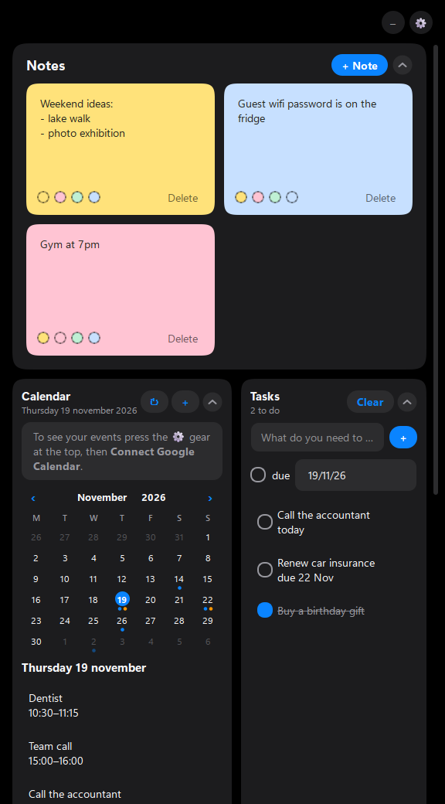
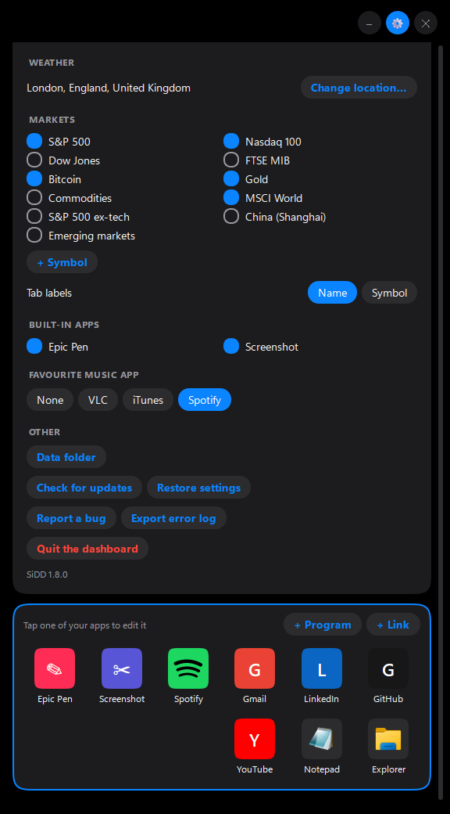

# SiDD · simple-desktop-dashboard

A native Windows sidebar dashboard (Python + PySide6) with an Apple-style squircle look.
It docks to the left or right edge of the screen, 30% of the width and the full height, and keeps your
notes, calendar, tasks, the weather, the markets and your favourite apps one glance away. No browser, no server, no account.



## Features

### Layout and look
- Frameless sidebar docked to the **left or right** edge: 30% of the screen width, full height (taskbar excluded); it re-docks by itself when screens change
- Apple-style **squircle** cards and iOS-style app icons
- Three appearances: **Dark** (default), **Light** and **Glass**, an Apple-style *liquid glass*:
  - the sidebar is transparent: whatever is behind it (windows, desktop) shows through, blurred by Windows (acrylic)
  - cards are glass panes with a **dynamic specular rim** and a soft sheen that follow the mouse pointer
  - a brighter top and a thin shadow on the bottom edge give the panes thickness
- Every card can be **collapsed** with its chevron, or **hidden** from the settings; the state is remembered
- Optional "stay on the desktop, below other windows" mode
- Starts with Windows (optional) and minimizes with the – button
- **Global keyboard shortcut** to show or hide the sidebar (default Ctrl+Alt+D, change it or turn it off in the settings)
- **Report a bug** from the settings: write what went wrong and send it (or open a pre-filled GitHub issue)
- **Updates**: at start-up (and every 12 hours) SiDD checks the latest GitHub release; when there is a newer one an "Update to x.y" button appears, downloads the new `SiDD.exe`, swaps it in and restarts. You can also check by hand from the settings
- **Restore settings** puts every setting back to its default, keeping notes, tasks, apps and calendars
- Languages: Italiano, English, Français, Español, 中文

### Notes
- Coloured sticky notes (yellow, pink, mint, blue), saved automatically while you type
- New notes get a **random colour**, never the same as the last one
- Change the colour with the dots, delete with confirmation

### Calendar
- **Google Calendar** sync through the secret iCal address (read-only, several calendars supported, refresh every 5 minutes)
- Compact month view: the current month stands out, days of other months are faded, today is a filled circle
- Dots under the days with **events** (blue) and **tasks due** (orange)
- Agenda of the selected day; + opens Google Calendar to create an event
- The mouse wheel scrolls the sidebar, never the month
- Today's date is shown under the title

### Tasks
- Quick add with an optional **due date**; overdue tasks turn red, due tasks show in the calendar too
- Tick to complete, "Clear" removes completed tasks
- Right-click to edit, send to Google Calendar or delete

### Weather
- Current conditions, feels-like temperature, wind, humidity and a **6-day forecast**
- Search your city in the settings; data from [Open-Meteo](https://open-meteo.com) (free, no API key), refreshed every 30 minutes

### Markets
- Pick one or more of six instruments in the settings: **S&P 500, Nasdaq 100, Dow Jones, FTSE MIB, Bitcoin, Gold**
- **Add your own**: any Yahoo Finance symbol (stocks such as `AAPL` or `ENI.MI`, ETFs, currencies such as `EURUSD=X`, crypto such as `ETH-USD`), shown in its own currency
- With more than one, the card shows **browser-style tabs** to switch between them
- Value and change over **3 days, this month and 1 year**; click a range to change the chart
- Data from Yahoo Finance with Stooq as fallback, refreshed every 15 minutes


### App launcher
- One-click tiles for **programs, files and links** (also URI schemes such as `spotify:` or `steam://`), with their system icons
- Tiles align to the right when the sidebar is docked right
- Press the ⚙ gear to enter **configuration mode**: add programs or links, right-click a tile to move, rename or remove it
- Built-in apps you can switch on in the settings:
  - **Epic Pen**
  - **Windows screenshot** (Snipping Tool)
  - **Favourite music app**: VLC, iTunes or Spotify
  - your own apps through `config.local.json` (see below), also tiles that open a small **menu of choices** (for example several profiles or versions of the same program)

### Privacy
- Everything stays on your PC in `%APPDATA%\SiDD\data.json` (settings → "Data folder")
- The only connections are to Google Calendar (your iCal address), Open-Meteo (weather for the location you set), Yahoo Finance/Stooq (market data), the GitHub API (update check) and, only when you send a bug report, the report form service



## Build

Requires Windows and Python 3.10+ (`build.bat` offers to install it with winget).

```bat
build.bat
```

It creates a virtual environment in `.build`, builds `SiDD.exe` with PyInstaller, adds a desktop shortcut and a startup entry, then opens the app.
To run from source: `run-from-source.bat` (after one build) or `python sidd.py`.

Windows may show "Windows protected your PC" because the exe is not signed: "More info" → "Run anyway".

## Connect Google Calendar

1. Open calendar.google.com → ⚙ → Settings, pick your calendar on the left.
2. Under "Integrate calendar", copy the **Secret address in iCal format**.
3. In SiDD press ⚙ → "Connect Google Calendar" and paste it (one address per line for several calendars).

The secret address gives access to your calendar: do not share it.

## Personal built-in apps

Copy `config.example.json` to `config.local.json` next to `SiDD.exe` to add your own built-in apps. `config.local.json` is ignored by git.

A preset has either a `path` (file, program or link) or a list of `choices`: each choice has a `label` shown in the menu, a `path`, optional `args` and an optional `check` path that must exist for the choice to be enabled.

## Files

| File | What it is |
| --- | --- |
| `sidd.py` | the whole app |
| `glass.py` | liquid glass panels (specular rim and sheen that follow the pointer) |
| `i18n.py` | translations |
| `build.bat` | builds `SiDD.exe` and the shortcuts |
| `run-from-source.bat` | runs `sidd.py` without building |
| `config.example.json` | example of personal built-in apps |
| `icon.ico` | app icon |

## Make it your own

SiDD is MIT-licensed: fork it, change it (by hand or with your favourite AI coding assistant) and build it with `build.bat`.
Almost everything lives in `sidd.py`, with comments.

Builds you make yourself **do not update automatically**, so an official release can never overwrite your changes.
To ship updates for your own fork, add your repository to `config.local.json` next to `SiDD.exe`:

```json
{ "update_repo": "your-name/your-fork" }
```

## Releasing an update

Official builds read two settings from `official.py`, which is not in git and exists only on the maintainer's PC:

```python
UPDATE_REPO = "owner/repo"                          # where updates come from
BUG_REPORT_URL = "https://formspree.io/f/your-form"  # where bug reports are sent
```

Bug reports go to a [Formspree](https://formspree.io) form: the maintainer's email address is stored only on Formspree, so it never appears in the app, in its traffic or in the source code. Without `BUG_REPORT_URL` the button opens a pre-filled GitHub issue instead.

1. Raise `APP_VERSION` in `sidd.py` and run `build.bat`.
2. Publish a GitHub release whose tag is the version and attach `SiDD.exe`:

```bat
gh release create v1.0.1 SiDD.exe --title "SiDD 1.0.1" --notes "What changed"
```

Installed copies find it at the next start-up. The check uses the public GitHub API, so the repository must be public.

## Translations

Strings live in `i18n.py`, keyed by the Italian text. Add a language to `LANGUAGES` and a column to each entry.

## License

MIT
